<div align="center">

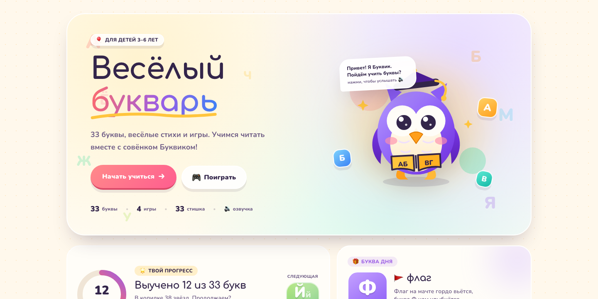

# Букварь

**Весёлая интерактивная азбука для детей 3–6 лет**

33 буквы · стихи · озвучка · 4 игры · прописи · звёзды

<a href="https://skilledify.github.io/bukvar/">
  
</a>

[](https://github.com/skilledify/bukvar/actions/workflows/deploy.yml)
[](https://github.com/skilledify/bukvar/actions/workflows/ci.yml)
[](#стек)
[](#стек)
[](#стек)
[](#стек)
[](LICENSE)

</div>

---

## О проекте

«Букварь» — это небольшая, но очень живая веб-азбука: 33 буквы с картинками, стихами и озвучкой, четыре мини-игры, прописи, звёзды и достижения. Всё работает в браузере, без регистрации и без сервера — прогресс хранится в `localStorage`.

Проект сделан как современное одностраничное приложение на **React + TypeScript + Vite + Tailwind CSS 4**. Под шапкой бежит строка из всех 33 букв, а в игре «Барабан букв» ребёнок может остановить барабан и назвать выпавшую букву вслух — браузер попробует её распознать.

## Демо

**https://skilledify.github.io/bukvar/**

Сайт опубликован на GitHub Pages. Для распознавания речи лучше всего подходит Chrome или Edge; в остальных случаях игра предложит ручную проверку взрослым.

## Скриншоты

<table>
  <tr>
    <td width="50%" valign="top">
      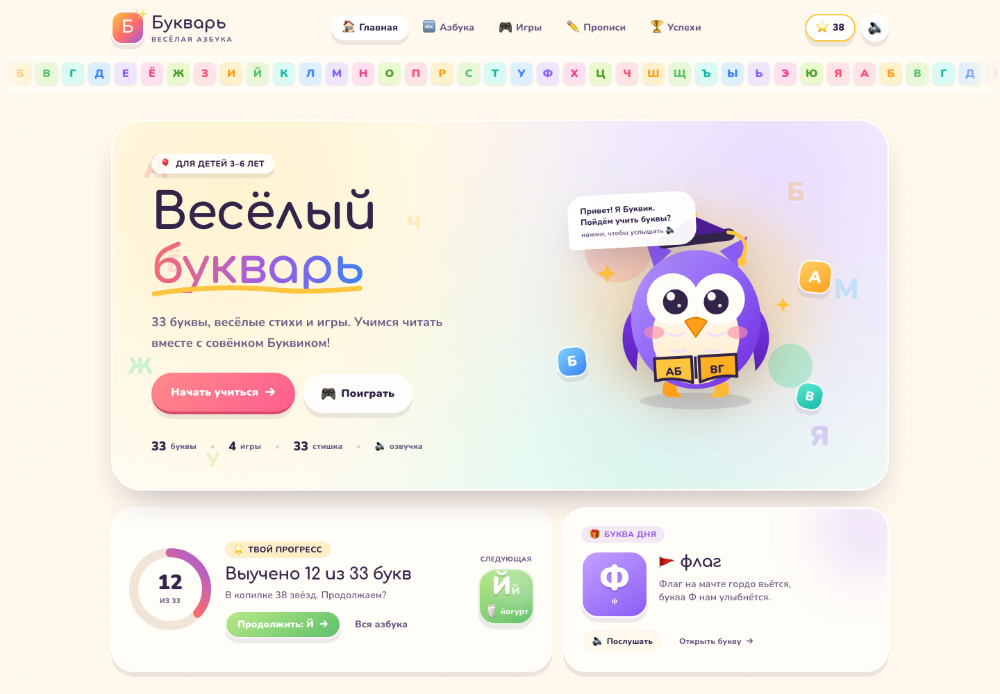
      <br />
      <sub><b>Главная</b> — герой, прогресс и бегущая строка под шапкой</sub>
    </td>
    <td width="50%" valign="top">
      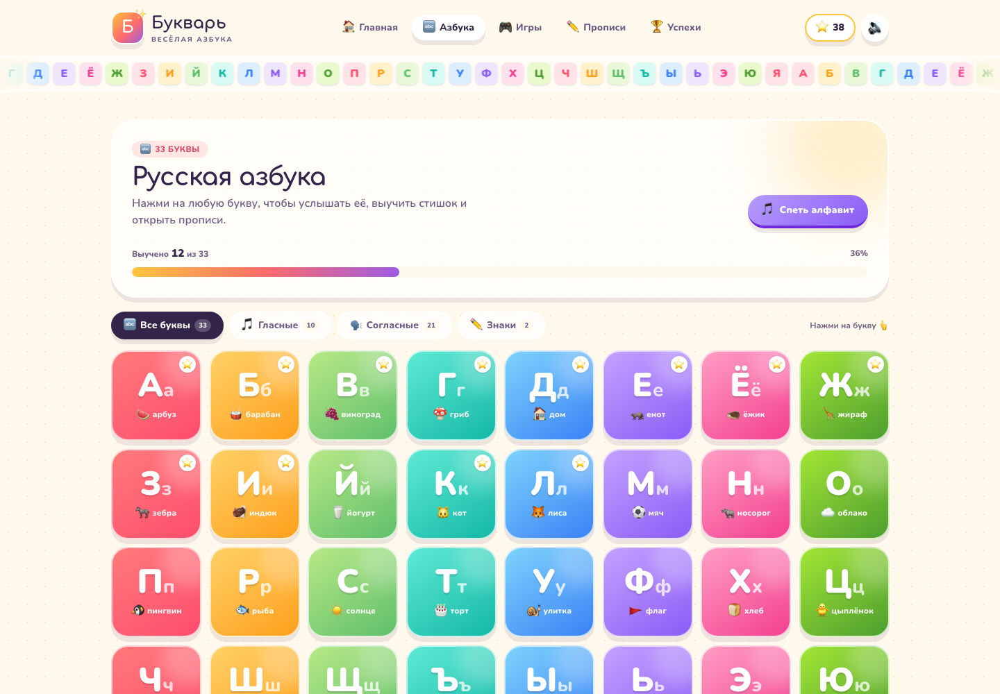
      <br />
      <sub><b>Азбука</b> — все 33 буквы, фильтры и прогресс изучения</sub>
    </td>
  </tr>
  <tr>
    <td width="50%" valign="top">
      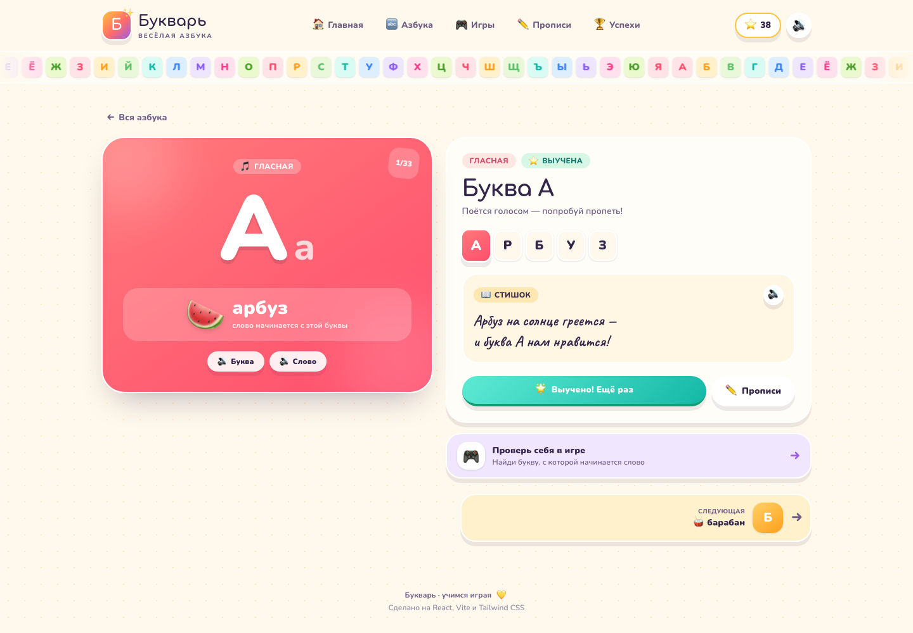
      <br />
      <sub><b>Буква</b> — картинка, слово, стишок и озвучка</sub>
    </td>
    <td width="50%" valign="top">
      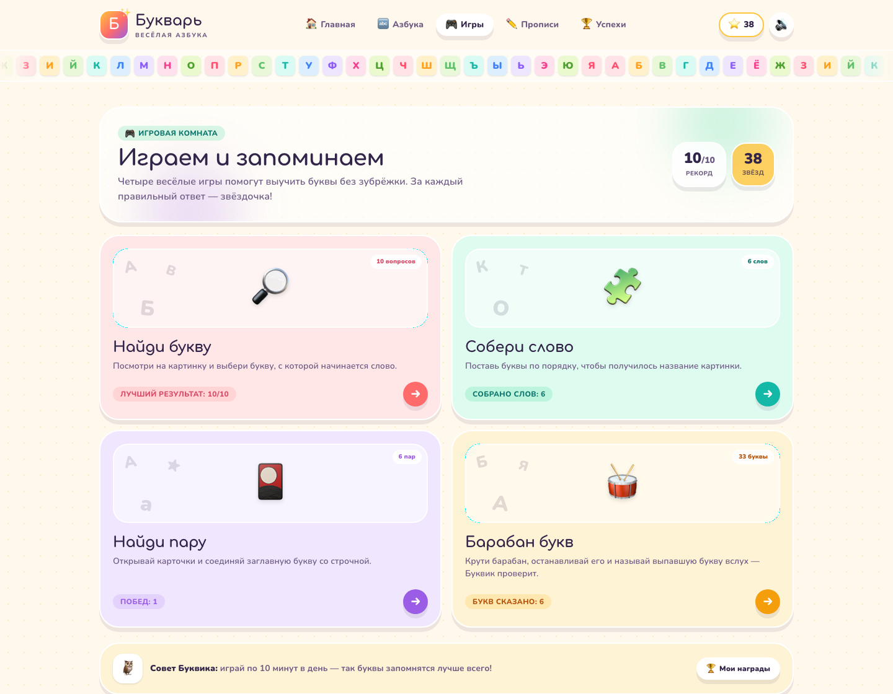
      <br />
      <sub><b>Игровая комната</b> — четыре игры и статистика</sub>
    </td>
  </tr>
  <tr>
    <td width="50%" valign="top">
      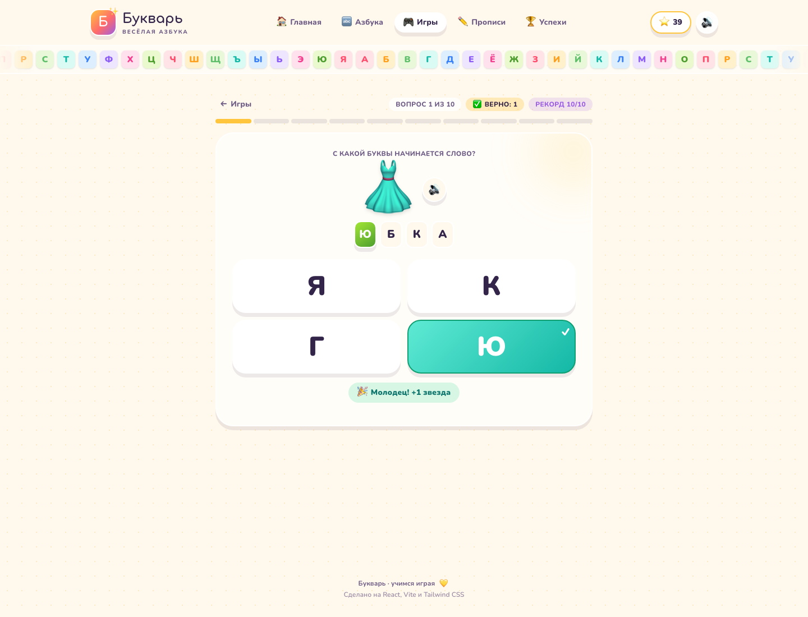
      <br />
      <sub><b>Найди букву</b> — 10 вопросов с картинками</sub>
    </td>
    <td width="50%" valign="top">
      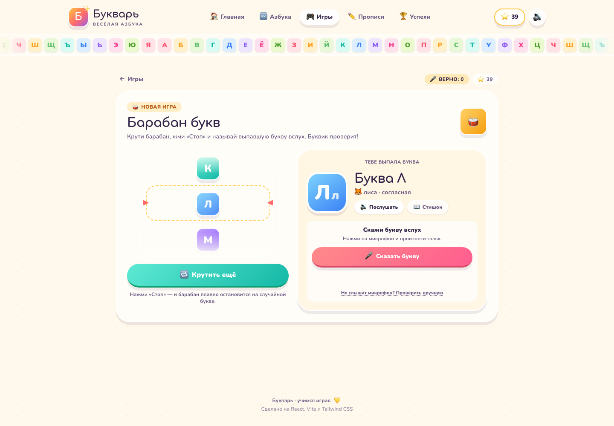
      <br />
      <sub><b>Барабан букв</b> — стоп, случайная буква и проверка произношения</sub>
    </td>
  </tr>
  <tr>
    <td width="50%" valign="top">
      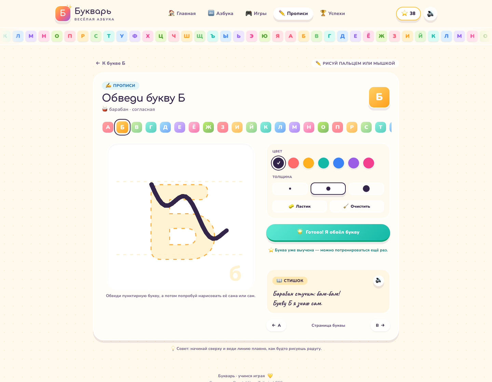
      <br />
      <sub><b>Прописи</b> — обведи букву пальцем или мышкой</sub>
    </td>
    <td width="50%" valign="top">
      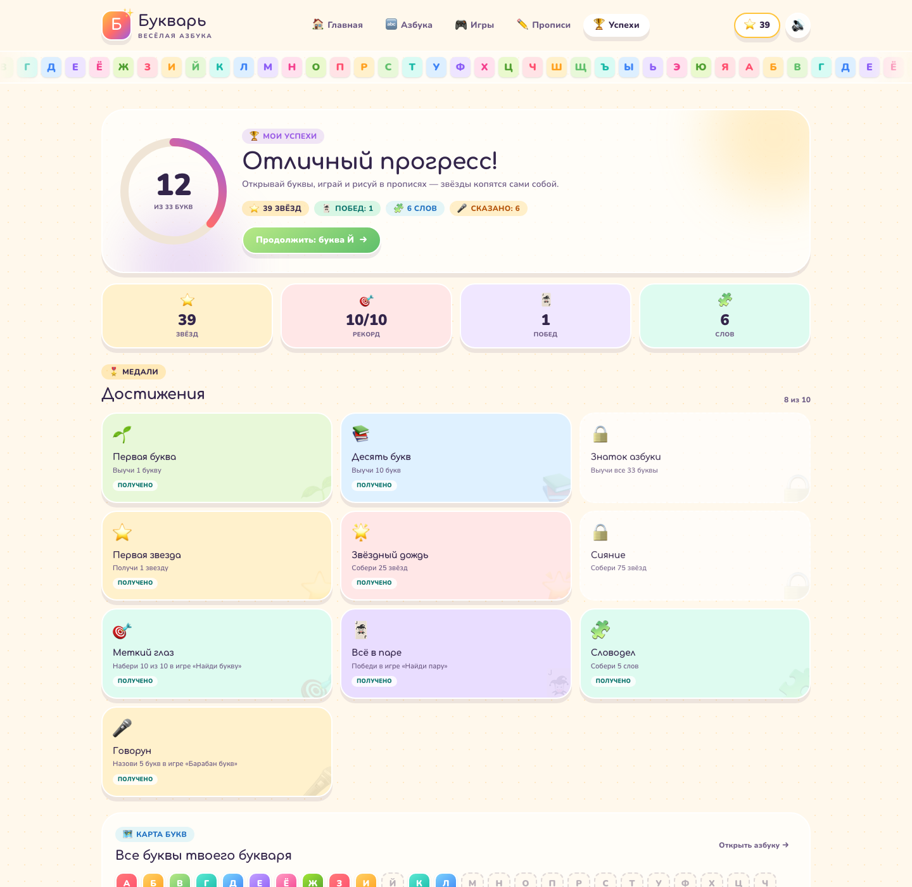
      <br />
      <sub><b>Успехи</b> — звёзды, рекорды и 10 достижений</sub>
    </td>
  </tr>
</table>

### На телефоне

<table>
  <tr>
    <td width="50%" align="center" valign="top">
      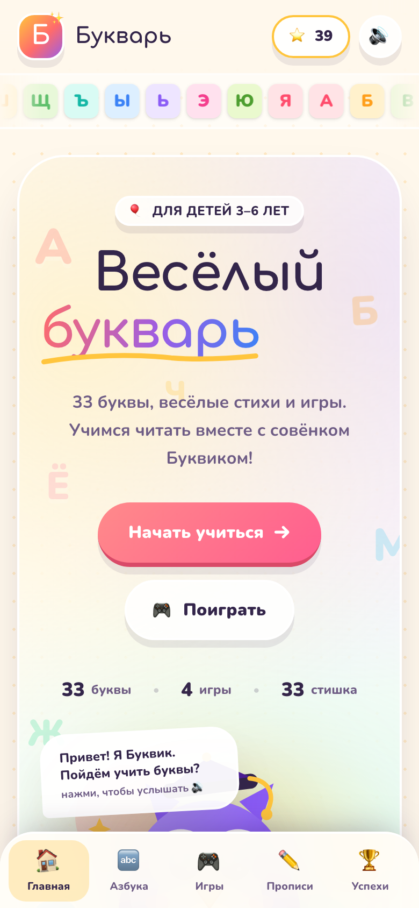
      <br />
      <sub>Главная</sub>
    </td>
    <td width="50%" align="center" valign="top">
      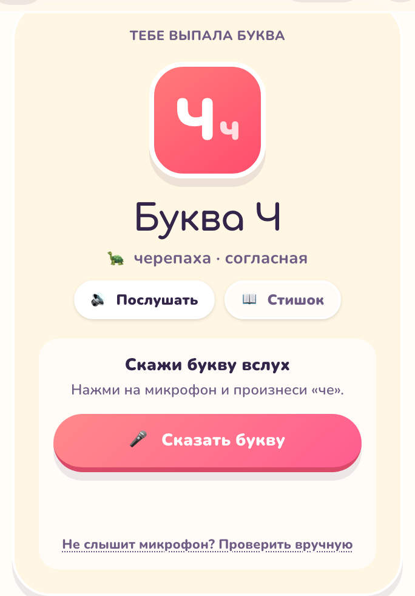
      <br />
      <sub>Барабан букв: выпала буква Ч</sub>
    </td>
  </tr>
</table>

## Возможности

| Возможность | Что делает |
|---|---|
| **33 буквы** | Отдельная страница для каждой буквы: заглавная и строчная, картинка, слово, тип буквы, стишок и озвучка. |
| **Бегущая строка** | Под шапкой на всех страницах едет бесшовная лента из всех 33 букв. Она специально продолжает двигаться даже при `prefers-reduced-motion`; остальные анимации при этом отключаются. |
| **Буква дня** | На главной — случайная буква дня с быстрым переходом к изучению. |
| **Песенка алфавита** | Режим «Спеть алфавит» подсвечивает буквы по очереди и произносит их. |
| **4 игры** | «Найди букву», «Собери слово», «Найди пару» и «Барабан букв». |
| **Прописи** | Canvas-поле: обведи пунктирную букву пальцем или мышкой, выбери цвет и толщину. |
| **Прогресс** | Изученные буквы, звёзды, рекорды, победы и достижения сохраняются в `localStorage`. |
| **Звук и праздник** | Web Audio для звуков, `speechSynthesis` для озвучки, конфетти и совёнок Буквик для поддержки. |
| **Мобильная версия** | Адаптивная вёрстка, нижняя навигация, крупные кнопки и удобное рисование пальцем. |
| **Доступность** | Семантическая разметка, `aria`-атрибуты, клавиатурная навигация, видимый фокус и уважение к `prefers-reduced-motion`. |

## Игры

| Игра | Механика | Награда |
|---|---|---|
| **Найди букву** | 10 вопросов: показана картинка, нужно выбрать первую букву слова из четырёх вариантов. | +1 звезда за верный ответ, +3 бонуса за результат 8/10 и выше. |
| **Собери слово** | 6 слов: расставь буквы в правильном порядке. | +2 звезды за слово, +3 бонуса за все шесть слов. |
| **Найди пару** | 6 пар карточек: соедини заглавную букву со строчной. | +1 звезда за пару, +3 бонуса за победу. |
| **Барабан букв** | Барабан крутится, ребёнок жмёт «Стоп», выпадает случайная буква — её нужно назвать вслух. | +2 звезды за верный ответ, буква попадает в копилку изученных. |

### Как работает «Барабан букв»

- Барабан — вертикальное «колесо» из всех 33 букв, которое плавно замедляется и останавливается на случайной букве.
- Проверка произношения использует **Web Speech API** (`SpeechRecognition`, `ru-RU`). Засчитывается и сама буква, и её название: «б» или «бэ», «й» или «и краткое».
- Если браузер не поддерживает распознавание, микрофон недоступен или ребёнок не расслышан, появляется кнопка **«Проверить вручную»** — взрослый может нажать «Верно».
- Аудио не отправляется на собственный сервер: приложение статическое. Обработку речи выполняет браузер и его речевой сервис.

## Стек

| Технология | Роль |
|---|---|
| [React 19](https://react.dev/) | UI и состояние |
| [TypeScript 6](https://www.typescriptlang.org/) | Типизация данных о буквах, прогресса и речи |
| [Vite 8](https://vite.dev/) | Дев-сервер и сборка |
| [Tailwind CSS 4](https://tailwindcss.com/) | Дизайн-система, адаптивность и анимации |
| [React Router 7](https://reactrouter.com/) | Маршруты (`HashRouter` — надёжно для GitHub Pages) |
| Web Speech API | Озвучка (`speechSynthesis`) и распознавание речи |
| Web Audio API | Короткие звуки интерфейса |
| Canvas 2D | Прописи |
| `localStorage` | Прогресс, звёзды и достижения |

## Быстрый старт

Понадобится **Node.js 20.19+** (в репозитории есть `.nvmrc` с версией 22).

```bash
git clone https://github.com/skilledify/bukvar.git
cd bukvar
npm install
npm run dev
```

Откройте [http://localhost:5173](http://localhost:5173).

### Скрипты

| Команда | Что делает |
|---|---|
| `npm run dev` | Запускает Vite с горячей перезагрузкой |
| `npm run build` | Проверяет типы и собирает production-версию в `dist/` |
| `npm run preview` | Показывает собранную версию локально |
| `npm run lint` | Запускает Oxlint |
| `npm run typecheck` | Проверяет TypeScript без сборки |

## Структура проекта

```text
.
├── .github/workflows/       # CI и деплой на GitHub Pages
├── docs/screenshots/        # Скриншоты для README
├── public/                  # favicon, og-image, .nojekyll
├── src/
│   ├── components/          # Layout, шапка, бегущая строка, Буквик, карточки
│   ├── context/             # прогресс, звук, конфетти
│   ├── data/letters.ts      # 33 буквы: слова, стихи, палитры
│   ├── lib/                 # речь, распознавание, утилиты
│   ├── pages/               # главная, азбука, буква, игры, прописи, успехи
│   ├── App.tsx              # маршруты
│   ├── index.css            # Tailwind, палитра и анимации
│   └── main.tsx             # точка входа
├── index.html
├── vite.config.ts
└── package.json
```

Ключевые файлы:

- `src/data/letters.ts` — единственный источник данных о буквах.
- `src/context/ProgressContext.tsx` — звёзды, изученные буквы, рекорды и достижения.
- `src/components/AlphabetTicker.tsx` — бегущая строка из всех 33 букв.
- `src/pages/DrumPage.tsx` — игра «Барабан букв».
- `src/lib/useSpeechRecognition.ts` — хук Web Speech API с аккуратной обработкой ошибок.

## Деплой на GitHub Pages

Деплой автоматический: каждый пуш в `main` запускает `.github/workflows/deploy.yml`, собирает проект и публикует `dist/` через GitHub Pages.

1. В настройках репозитория выберите **Settings → Pages → Source: GitHub Actions**.
2. Отправьте изменения в `main`.
3. Дождитесь завершения workflow **Deploy to GitHub Pages**.

`vite.config.ts` автоматически берёт имя репозитория из `GITHUB_REPOSITORY` и выставляет `base` как `/<repo>/`. Для нестандартного пути можно переопределить базу:

```bash
VITE_BASE=/my-folder/ npm run build
```

Приложение использует `HashRouter`, поэтому прямые ссылки вида `/#/games/drum` работают на статическом хостинге без серверных rewrite-правил. Файл `public/.nojekyll` отключает обработку Jekyll.

## Голос и микрофон

- **Озвучка** использует голоса, установленные в системе. Если русского голоса нет, браузер может выбрать другой — это нормально.
- **Распознавание речи** лучше всего работает в Chrome и Edge. Нужен HTTPS (GitHub Pages подходит) или `localhost`, а также разрешение на микрофон.
- Если распознавание не поддерживается или произошла ошибка, игра не блокирует ребёнка: всегда доступна ручная проверка.
- Звук интерфейса можно выключить кнопкой динамика в шапке; настройка сохраняется.

## Доступность и мобильные устройства

- Все интерактивные элементы доступны с клавиатуры, у кнопок есть подписи и `aria`-состояния.
- Основные анимации отключаются при `prefers-reduced-motion: reduce`. Исключение — бегущая строка: по задумке она движется всегда.
- На мобильных появляется нижняя навигация, а прописи поддерживают рисование пальцем.
- Контент не выходит за пределы экрана на ширине от 360 px.

## Участие

Идеи, замечания и пул-реквесты приветствуются.

1. Форкните репозиторий.
2. Создайте ветку: `git checkout -b feature/my-idea`.
3. Внесите изменения и проверьте: `npm run lint && npm run typecheck && npm run build`.
4. Откройте пул-реквест с коротким описанием.

Если нашли баг, приложите браузер, версию ОС и шаги воспроизведения — так исправлять будет проще.

## Лицензия

Проект распространяется по лицензии [MIT](LICENSE).

---

<div align="center">

Сделано с 💛 для маленьких читателей.

Если «Букварь» пригодился — поставьте ⭐ репозиторию.

</div>
